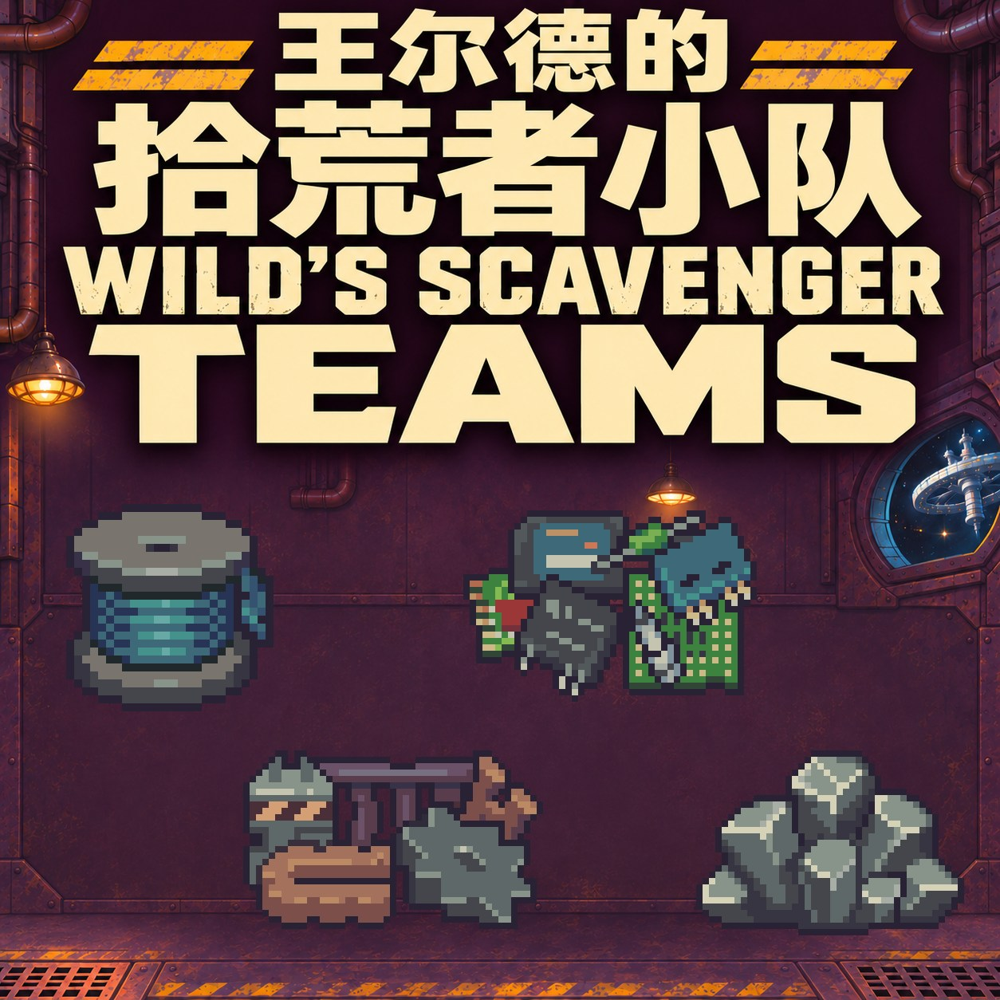

# Wild's Scavenger Teams — 0.3.0-dev

Local candidate: a fifth, bottle-only route (6 / 12 / 18 original wine bottles, no junk) and an independent six-option supply phone (72283) are ready for in-game testing. Each team can be paused independently and manually resumed after three days; delivery restarts the next day without catch-up or a renewed first discount. Public Workshop remains the accepted 0.2.1. See [candidate notes](docs/CANDIDATE_0.3.0.zh-CN.md).

A Probably Stolen mod adding reliable deliveries of printer filament, scrap metal, common electronic components, and asteroid ore through Wild's Network.

[简体中文](README.zh-CN.md) · [Build instructions](docs/BUILD.md) · [MIT license](LICENSE) · [GitHub source](https://github.com/Drlinglong/ProbablyStolenScavengerTeams) · [Steam Workshop](https://steamcommunity.com/sharedfiles/filedetails/?id=3835169100)

## Play

Find **Scavengers** on the **Basic** page of Wild's Network. Each resource has three service tiers. The first visitor arrives the day after purchase, then every three days without taking a random-customer slot.

| Tier | Useful cargo | Junk |
| --- | --- | --- |
| I | 6 loose resources | 2 |
| II | 2 crates | 4 |
| III | 3 crates | 6 |

Each 3×3 crate unpacks into 6 original resources. Leave storage space before double-clicking an owned crate. Buy selected goods at normal prices, or the entire remaining shipment including junk at half price on the first visit and 15% off afterward. Upgrades replace the load without duplicating suppliers, rescheduling deliveries, or renewing the introductory discount.

Base service fees: 200 / 300 / 450 credits, except electronic components at 250 / 350 / 500. Goods cost extra; native difficulty and character modifiers apply. Useful cargo is placed before junk; overflow follows the base game's destruction behavior.

## Languages

简体中文 · English · Français · Deutsch · 日本語 · Русский · Español · Polski

All eight languages are included in this Mod's `Localization` directory. No separate translation Mod or Remis runtime is required. The Chinese source and sequential dialogue have user in-game acceptance; the seven other languages were produced using OpenAI GPT-6 Luna at medium reasoning through [Remis](https://github.com/Drlinglong/Remis). Their keys, placeholders, tags and dialogue boundaries have been checked, and the user has confirmed multilingual display works in game. Wording feedback is welcome. See [localization provenance](docs/LOCALIZATION_PROVENANCE.json).

## Compatibility

Adds services, suppliers and crates without replacing game files or original item definitions. Designed for existing saves, with stable upgrade/item IDs and independent saved delivery state. Tested gameplay baseline: game 0.46D, Steam build 26496118. Other Mods changing the network panel, customer generation or wholesale trading may interact. Unpack or dispose of custom crates before removal.

## Source and verification

The project is open source under MIT. It includes C# sources, API doubles, 68 host regression checks, original artwork sources, prompts, and final textures. Use [the build guide](docs/BUILD.md) to compile against your own game installation. No game assemblies, external compiler, saves or private test-money Mod are distributed. Host tests do not replace Unity or in-game verification.

Workshop assets: [English description](docs/WORKSHOP.en.bbcode.txt), [简体中文描述](docs/WORKSHOP.zh-CN.bbcode.txt), [cover JPG](assets/workshop/cover-0.2.1-staggered-icons-zh-en.jpg), [full PNG](assets/workshop/cover-0.2.1-staggered-icons-zh-en.png).

The private test-money Mod remains a separate, unpublished repository.

User has since confirmed multilingual display works in game (individual tested locales were not listed). The Mod browser name and description now use plain English to avoid font issues; gameplay locale CSVs are unchanged.
