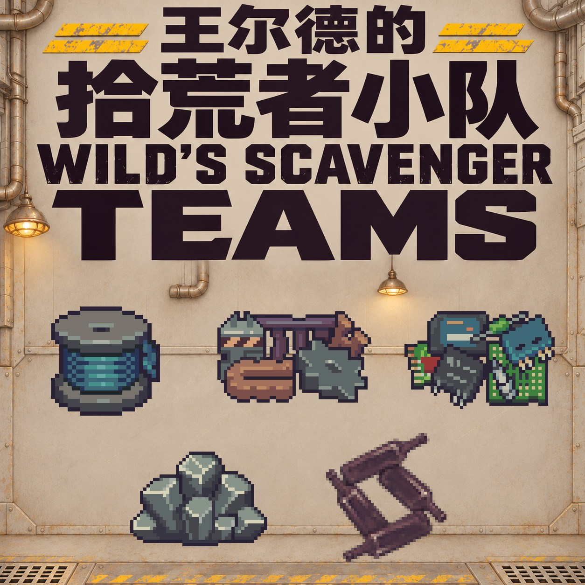

# Wild's Scavenger Teams — 0.3.0

Reliable material and empty wine-bottle deliveries for Probably Stolen, purchased through Wild's Network. The author has confirmed the five supply routes and the independent phone pause/resume controls work in game on 0.46D.

[简体中文](README.zh-CN.md) · [Build instructions](docs/BUILD.md) · [MIT license](LICENSE) · [GitHub source](https://github.com/Drlinglong/ProbablyStolenScavengerTeams) · [Steam Workshop](https://steamcommunity.com/sharedfiles/filedetails/?id=3835169100)

## Play

Find **Scavengers** on the **Basic** page of Wild's Network. Each of the five resources has three service tiers. The first visit arrives the day after purchase, then every three days, in addition to the normal random customers.

| Route | Tier I | Tier II | Tier III | Base service fees |
| --- | --- | --- | --- | --- |
| Printer filament | 6 loose + 2 junk | 2 crates + 4 junk | 3 crates + 6 junk | 200 / 300 / 450 |
| Scrap metal | 6 loose + 2 junk | 2 crates + 4 junk | 3 crates + 6 junk | 200 / 300 / 450 |
| Common electronics | 6 loose + 2 junk | 2 crates + 4 junk | 3 crates + 6 junk | 250 / 350 / 500 |
| Asteroid ore | 6 loose + 2 junk | 2 crates + 4 junk | 3 crates + 6 junk | 200 / 300 / 450 |
| Empty wine bottles | 6 bottles | 12 bottles | 18 bottles | 200 / 300 / 450 |

Each 3×3 crate unpacks into 6 original resources. Leave storage space before double-clicking an owned crate. Bottles are the original winemaking containers and arrive without junk or crates.

Buy selected goods at regular prices, or the entire remaining shipment at half price on the first visit and 15% off afterward. Service fees are paid once per tier; goods cost extra. Native difficulty and character modifiers apply. Upgrades replace the load without duplicating suppliers or resetting the delivery date or first discount. Cargo is placed before junk; overflow follows the base game's destruction behavior.

Call **Scavenger Squad, 72283**, to pause each team independently. After three game days, call again to resume. Deliveries restart the following day, without catch-up shipments or a renewed first discount. Upgrades and saves retain pause state.

## Languages and verification

简体中文 · English · Français · Deutsch · 日本語 · Русский · Español · Polski

All eight languages are embedded: no translation companion or Remis runtime is needed. Initial localization used OpenAI GPT-6 Luna at medium reasoning through [Remis](https://github.com/Drlinglong/Remis); short instructions and later wording were added directly by Codex. There are 63 keys per language with structural checks. User testing confirmed multilingual display for the earlier release and the new bottle and phone functionality; this does not establish professional proofreading of every sentence.

90 host regressions, native assembly compilation and the native ModScanner pass. See [0.3.0 release and acceptance](docs/RELEASE_0.3.0.zh-CN.md), [build instructions](docs/BUILD.md), and [localization provenance](docs/LOCALIZATION_PROVENANCE.json).

## Compatibility and source

The mod adds services, suppliers and crates without replacing original game files or item definitions. Existing save keys remain compatible. Other mods changing the network, phone UI, customers or wholesale trading can still interact. Unpack or dispose of custom crates before removal.

Source, artwork prompts, final sprites and build instructions are included here. Game assemblies, extracted raw sprites, player saves, compiler dependencies, credentials and the private test-money mod are excluded. Only the mod's own work is covered by the MIT license; original game artwork used in the promotional cover belongs to its rights holders.
